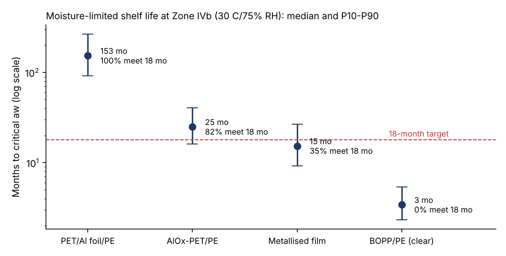
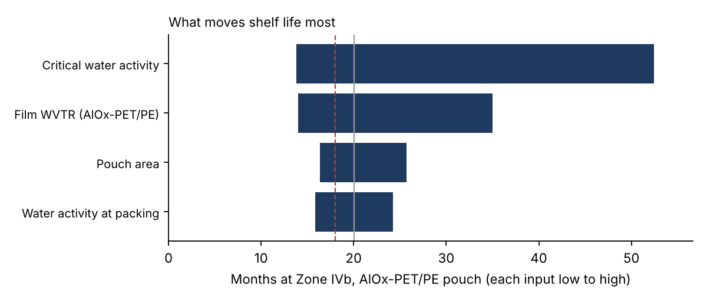

# Packaging Shelf-Life Model for Moisture-Sensitive Nutrition Powders

Which pouch film does a milk-protein nutrition powder need to last 18 months in Indian storage conditions, and what does a 6-month accelerated test actually prove?

This model computes how long a 500 g pouch of powder takes to absorb enough water to reach its critical water activity (where caking and lactose crystallisation start). It covers 4 pack films and 3 storage conditions, puts ranges on every input, and checks what the standard 40 °C/75% RH accelerated test is worth for two different failure modes.

## Answer

| Pack film | Zone IVa 30 °C/65% | Zone IVb 30 °C/75% | Accelerated 40 °C/75% | P(≥ 18 months at IVb) |
|---|---|---|---|---|
| PET/Al foil/PE | 182 months | 140 | 81 | 100% |
| AlOx-PET/PE | 26.1 | **20.0** | 11.5 | 82% |
| Metallised film | 18.2 | 14.0 | 8.1 | 35% |
| BOPP/PE (clear) | 3.6 | 2.8 | 1.6 | 0% |

Base case shown; probability from 20,000 Monte Carlo draws.

1. **AlOx-PET/PE is the lightest film that meets 18 months at Zone IVb**, with an 82% chance across the input ranges. Metallised film fails at IVb (14 months) and BOPP fails anywhere (under 4 months). Foil is about 7× over target, so it buys margin, not shelf life.
2. **The powder fails after gaining only about 12 g of water per 500 g pack**, which is why barrier quality dominates.
3. **What drives the result:** the critical water activity (13.8 to 52.4 months across its range) and the film's WVTR (14.0 to 35.0 months) matter far more than pouch size or packing moisture. Measuring the critical aw of the actual formulation is the single most valuable test.
4. **One acceleration factor can't cover both failure modes.** A 6-month test at 40 °C/75% RH equals about 17.4 months at 30 °C for vitamin C loss (Arrhenius, Ea 84.1 kJ/mol) but only about 10.4 months for moisture uptake. Passing a 6-month accelerated test does not prove 18 months of moisture protection.




## Method

- **Isotherm:** GAB model for MPC80 at 25 °C, m = m0·C·K·aw / ((1 − K·aw)(1 − K·aw + C·K·aw)).
- **Film permeance:** P = WVTR / (0.90 × p_sat(37.8 °C)), from WVTR datasheets measured at 38 °C/90% RH (ASTM F1249 condition).
- **Shelf life:** t = mass · solids / (P · A · p_sat(T)) × ∫ dm / (RH − aw), from packing aw to critical aw, 400-step midpoint rule. Saturation pressure from the Buck equation.
- **Uncertainty:** 20,000 independent triangular draws on low/base/high for every input (seed 11); one-at-a-time tornado.
- **Accelerated testing:** Arrhenius factor for vitamin C; vapour-pressure ratio for moisture uptake at equal RH.

Every input, range and source is in [`data/inputs.csv`](data/inputs.csv).

## Excel model

[`model/Packaging_Shelf_Life_Model.xlsx`](model/Packaging_Shelf_Life_Model.xlsx) is a live model: 2,859 formulas on named input cells, with the moisture integral laid out step by step. Type a value in the yellow Override column (a new film's WVTR, your measured critical aw) and the shelf life recalculates. `src/verify_excel.py` checks the recalculated workbook against Python; they match.

## Run

```bash
pip install -r requirements.txt
python src/run_all.py      # results/, charts/, Excel model
pytest -q                  # 8 tests
```

## Limits

- Model outputs on published data and stated assumptions, not measured shelf lives. The isotherm is for MPC80, not a finished milk mix with sugar, cocoa and premix.
- Film permeance is held constant with temperature, which overstates water uptake at 30 °C (conservative).
- Ignores seal and pinhole leakage, headspace, and the pack being opened. After opening, the consumer's kitchen sets shelf life, not the film.
- Pouch area, fill mass, critical aw base case and the 18-month target are assumptions.
- Vitamin C kinetics come from one published activation energy; other vitamins and flavour loss have their own.

See [`docs/test_protocol.md`](docs/test_protocol.md) for the lab tests that would replace the assumptions.
